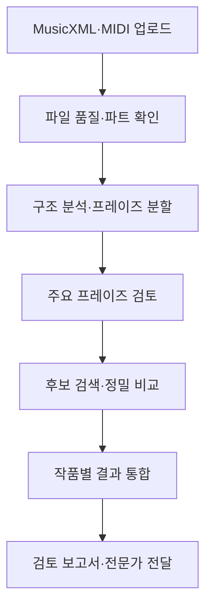
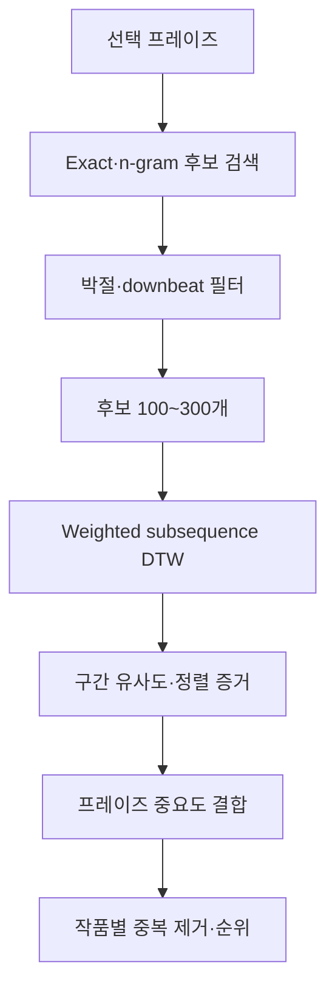

# MUSICANOTE 창작물 사전검토 개발 명세

- 문서 상태: 기획·개발 기준안 v1.0
- 작성일: 2026-09-14
- 대상: 창작자가 MusicXML 또는 MIDI를 업로드하면 주요 프레이즈를 찾아 검색 데이터베이스와 비교하는 신규 메뉴
- 권장 메뉴명: `창작물 사전검토`
- 권장 영문명: `Creator Pre-clearance`
- 권장 부제: `유사 멜로디 및 저작권 위험 분석`

## 0. 확정 결정 요약

1. 기존의 짧은 멜로디 직접입력 검색과 분리된 신규 메뉴로 만든다.
2. 전체 업로드 작품을 곧바로 검색하지 않고 `정규화 → 주선율 추출 → 구조/프레이즈 분석 → 중요도 평가 → 주요 프레이즈 검색` 순서로 처리한다.
3. 기존 구조 분석기의 프레이즈 경계 결과를 재사용하되, 별도의 `Phrase Importance Scorer`를 추가한다.
4. 업로드 작품과 검색 DB 작품 양쪽에서 해당 프레이즈가 얼마나 중요한지를 각각 평가한다.
5. 빠른 후보 검색 후 제한된 후보에만 weighted subsequence DTW를 실행한다. 전체 corpus에 DTW를 실행하지 않는다.
6. 검색 결과는 프레이즈가 아니라 작품 단위로 묶는다. 동일 주제의 반복과 여러 판본이 결과를 과도하게 점유하지 않게 한다.
7. 최종 지표는 `저작권 침해 확률`이 아니라 `음악적 유사성`, `구조적 중요도`, `독창성`, `분석 신뢰도`, `종합 검토 우선순위`로 표시한다.
8. Schenkerian/Ursatz 분석은 확정적 정답이 아니라 구조음 중요도를 조절하는 confidence-gated 보조 feature로 사용한다.
9. 미발표 창작물은 기본적으로 검색 corpus나 학습 데이터에 편입하지 않는다. 원본 보관과 데이터 제공은 별도 동의를 받는다.
10. 첫 번째 버전은 법률 판단이나 국가별 침해 판정을 하지 않는다. 전문가가 검토할 음악적 증거를 생성하는 pre-clearance 도구로 한정한다.
11. MusicXML과 MIDI 품질 차이를 명시하고, MIDI의 melody track 자동 추정 결과를 사용자가 확인·변경할 수 있게 한다.
12. 개발 전 현재 구조 분석기·검색기·DB의 성능 baseline을 계측한다. production 전환은 검증 후 별도 결정한다.

## 1. 제품 목표

### 1.1 사용자 문제

창작자는 곡 전체를 완성한 뒤 다음 질문에 답하기 어렵다.

- 내가 만든 곡의 핵심 선율이 기존 곡과 우연히 비슷한가?
- 비슷한 부분이 단순한 음계·종지·관습적 진행인가, 식별력 있는 프레이즈인가?
- 그 프레이즈는 내 곡과 기존 곡에서 각각 얼마나 중요한 역할을 하는가?
- 어떤 음, 리듬, 강박, 화성 기능이 비슷하다고 판단되었는가?
- 전문가에게 우선 검토를 요청해야 할 결과는 무엇인가?

### 1.2 목표

- MusicXML/MIDI 전체 작품에서 주요 프레이즈를 자동 추출한다.
- 조옮김, 템포 비율 변화, 장식음, 일부 삽입·생략·대체가 있어도 유사 구간을 찾는다.
- 업로드 곡과 DB 곡 양쪽의 구조적 중요도를 순위에 반영한다.
- 일반적인 짧은 패턴과 식별력 있는 프레이즈를 구분한다.
- 결과 악보, 정렬 경로, 마디·박, 점수 구성, A/B 재생으로 판단 근거를 설명한다.
- 미발표 작품을 안전하게 처리하고 사용자가 저장·삭제 범위를 통제하게 한다.
- 장기적으로 전문가 판정과 판례 데이터를 연결할 수 있는 evidence record를 만든다.

### 1.3 비목표

- 검색 점수만으로 저작권 침해를 확정하는 기능
- `침해 확률 82%`와 같은 법률 확률 표시
- 창작자가 기존 곡에 접근했는지 자동 판정
- 손해배상액 또는 소송 결과 예측
- 오디오 fingerprint/동일 음원 검색
- 완전 자동이며 단일 정답을 주장하는 Ursatz 분석
- 업로드 파일의 무단 corpus·학습 데이터 편입
- 매 검색마다 XML 원본 전체를 다시 파싱하는 구조
- 전체 DB의 모든 프레이즈에 DTW를 수행하는 구조

## 2. 사용자 흐름



### 2.1 단계별 UX

1. 사용자가 MusicXML, MXL, MID 또는 MIDI 파일을 업로드한다.
2. 시스템이 파일 형식, 파트, 박자, tempo map, 음표 수, 분석 가능 여부를 확인한다.
3. 시스템이 주선율 파트/성부를 추정한다. 사용자는 분석 전에 이를 확인하거나 변경한다.
4. 기존 구조 분석기가 section, phrase, cadence와 confidence를 반환한다.
5. 중요도 평가기가 주요 프레이즈 3개와 보조 프레이즈 2~4개를 제안한다.
6. 사용자는 프레이즈 시작·끝, 중요/보조 상태, 검색 제외 여부를 수정할 수 있다.
7. 시스템이 선택된 프레이즈를 검색하고 결과를 작품별로 통합한다.
8. 결과 화면은 유사 악보, A/B 재생, 점수 구성, 중요도, 권리 메타데이터를 보여준다.
9. 사용자는 결과를 보관하거나 PDF/HTML 보고서로 내보내 전문가에게 전달한다.

## 3. 입력 파일 및 전처리

### 3.1 지원 형식

MVP 필수:

- `.musicxml`
- `.xml` 중 MusicXML 문서
- `.mxl`
- `.mid`
- `.midi`

파일 확장자만 신뢰하지 말고 MIME, 헤더, XML root를 검사한다. 압축 폭탄, 비정상적으로 큰 파일, 외부 엔티티, path traversal을 차단한다.

### 3.2 MusicXML 처리

- part/staff/voice identity를 보존한다.
- measure, beat, time signature, key, tempo, duration을 정규화한다.
- tie는 logical note로 병합하되 원본 note ID mapping을 유지한다.
- grace note, rest, chord, tuplet, repeat/ending을 명시적으로 처리한다.
- harmony symbol, articulation, dynamics, lyric, part name은 존재할 때 feature와 설명에 활용한다.
- 반복기호를 performance order로 확장한 map과 원본 score location을 함께 보존한다.

### 3.3 MIDI 처리

- tempo map과 time signature event를 읽는다.
- percussion channel과 명백한 drum track을 제외한다.
- sustain pedal로 늘어난 note-off를 선율 음가와 분리해 보정한다.
- onset과 duration을 beat grid에 quantize하되 원시 tick/time도 보존한다.
- track name, program, monophony, 평균 음역, note density, 반복성과 최상성부 비율로 melody 후보를 추정한다.
- 다성 track은 voice separation 후 복수 melody stream 후보로 만든다.
- 조표와 enharmonic spelling이 불확실하면 semitone feature를 기준으로 하고 diatonic feature에 낮은 confidence를 준다.
- 분석 화면에서 자동 선택한 melody track과 대체 후보를 보여준다.

### 3.4 업로드 품질 상태

```ts
type UploadQuality = "good" | "usable_with_warnings" | "needs_user_action" | "unsupported";

interface UploadDiagnostic {
  code: string;
  severity: "info" | "warning" | "error";
  message: string;
  affectedPartIds?: string[];
  suggestedAction?: string;
}
```

다음 경우 사용자 확인을 요구한다.

- melody 후보 1·2위의 점수 차이가 작음
- 박자표가 없거나 중간에 비정상적으로 자주 변경됨
- 전체가 다성 chord track이며 독립 선율이 불명확함
- 5음 미만의 지나치게 짧은 작품/파트
- 극단적인 quantization 오차
- 구조 분석 confidence가 임계값 미만

## 4. 분석 데이터 모델

원본 MusicXML/MIDI를 검색 계산의 직접 입력으로 반복 사용하지 않는다. 업로드 시 Canonical Music IR로 한 번 변환한다.

```ts
interface AnalysisJob {
  id: string;
  ownerId: string;
  status: "uploaded" | "normalizing" | "structuring" | "searching" | "completed" | "failed" | "deleted";
  sourceFormat: "musicxml" | "mxl" | "midi";
  parserVersion: string;
  structureAnalyzerVersion: string;
  phraseImportanceVersion: string;
  searchFeatureVersion: string;
  scoreConfigVersion: string;
  retentionPolicy: "delete_after_analysis" | "retain_private";
  createdAt: string;
  completedAt?: string;
}

interface MelodyStream {
  id: string;
  partId: string;
  staffId?: string;
  voiceId?: string;
  extractionMethod: string;
  melodyRoleScore: number;
  roleConfidence: number;
  userConfirmed: boolean;
}

interface PhraseCandidate {
  id: string;
  melodyStreamId: string;
  sectionId?: string;
  startEventId: string;
  endEventId: string;
  startMeasure: number;
  startBeat: number;
  endMeasure: number;
  endBeat: number;
  boundaryConfidence: number;
  importanceScore: number;
  importanceComponents: Record<string, number>;
  importanceConfidence: number;
  phraseRole: "primary" | "secondary" | "excluded";
  canonicalPhraseId?: string;
  userEdited: boolean;
}
```

모든 분석 결과는 version을 기록한다. 분석기나 weight 변경 후 과거 결과를 재현하거나 선택적으로 재분석할 수 있어야 한다.

## 5. 프레이즈 경계와 사용자 수정

### 5.1 구조 분석기 연동

기존 구조 분석기가 반환하는 최소 계약:

- phrase 시작·종료 event 또는 onset
- section ID와 section type hypothesis
- cadence 위치와 유형
- phrase boundary confidence
- 분석 경고

정확한 현재 출력 계약이 다르면 adapter를 만들고 구조 분석기 내부를 이번 기능 때문에 즉시 재작성하지 않는다.

### 5.2 자동 경계 후처리

- 3음 이하 또는 지나치게 짧은 프레이즈는 인접 프레이즈와 병합 후보로 표시한다.
- 긴 프레이즈는 내부 cadence, rest, 반복 motif를 사용해 검색용 subphrase를 만들 수 있다.
- pickup/anacrusis를 phrase에 포함하되 metric position을 보존한다.
- 반복된 동일·변형 프레이즈는 `canonicalPhraseId`로 묶는다.
- 경계 confidence가 낮은 프레이즈는 검색은 가능하지만 결과 신뢰도를 낮춘다.

### 5.3 편집 UI

- Verovio 악보에 section과 phrase를 색상 또는 bracket으로 표시한다.
- phrase 양 끝 handle을 드래그해 경계를 수정한다.
- `주요`, `보조`, `검색 제외`를 선택한다.
- 다른 part/voice를 주선율로 선택할 수 있다.
- 수정 후 해당 프레이즈와 영향을 받는 집계만 다시 계산한다.
- 자동 결과와 사용자 수정값을 모두 correction log에 저장한다.

## 6. 프레이즈 중요도 평가

### 6.1 기본 원칙

프레이즈 중요도는 `많이 반복됨`과 동일하지 않다. 반주 ostinato, bass riff, scale, sequence가 주제보다 높게 평가되지 않도록 melody-role gate를 먼저 적용한다.

### 6.2 권장 초기 구성

| 요소 | 초기 비중 | 예시 |
|---|---:|---|
| 선율적 전면성 | 25% | 주선율 성부, 독립적 melodic line, 음역·지속시간 |
| 반복·재등장 | 20% | 동일/변형 재등장, 후렴 반복 |
| 구조적 위치 | 20% | 도입 주제, 후렴 시작, section opening/closing |
| 박절·지속시간 | 15% | 강박, 긴 음, phrase apex |
| 종지·화성 기능 | 10% | cadence 도달, 긴장과 해결, 비화성음 해결 |
| 구조음 중요도 | 10% | foreground/middleground reduction과 confidence |

가중치는 versioned configuration으로 관리하며 하드코딩하지 않는다.

### 6.3 중요도 산출 조건

- `melodyRoleScore`가 낮으면 전체 중요도 상한을 제한한다.
- structure/harmony confidence가 낮으면 해당 요소의 weight를 0으로 만들고 나머지를 재정규화한다.
- 단순 반복 횟수는 log 또는 capped transform을 사용한다.
- 같은 canonical phrase의 반복은 중요도에는 제한적으로 반영하고 검색 task를 중복 생성하지 않는다.
- 업로드 작품과 corpus 작품에 동일한 중요도 모델과 version을 적용하는 것을 원칙으로 한다.

### 6.4 검색 대상 선정

기본값:

- 주요 프레이즈: 상위 3개
- 보조 프레이즈: 2~4개
- 최소 유효 음표 수: 7음 권장, 5~6음은 경고와 높은 distinctiveness threshold 적용
- 최대 검색 task: canonical phrase 기준 7개

## 7. 유사 멜로디 검색 파이프라인

### 7.1 전체 구조



### 7.2 후보 검색

후보 인덱스 feature:

- semitone interval n-gram
- diatonic interval n-gram과 confidence
- relative pitch
- contour 5종 `LU`, `SU`, `SAME`, `SD`, `LD`
- normalized duration/IOI n-gram
- rest/silence pattern
- metric/downbeat position
- phrase length bucket
- melody role와 source metadata filter

관계형 DB가 source of truth다. Elasticsearch/OpenSearch가 이미 있으면 후보 검색 sidecar로 사용한다. 없다면 corpus 규모와 현재 DB를 측정한 뒤 indexed SQL n-gram table을 우선 검토한다. 최종 DTW 점수를 검색엔진의 opaque score에 맡기지 않는다.

### 7.3 정밀 재평가

권장 초기 구성:

| 요소 | 초기 비중 |
|---|---:|
| 음정 진행·subsequence DTW | 35% |
| 리듬 비율·rhythm DTW | 15% |
| downbeat·metric position | 15% |
| contour 5종 | 10% |
| 화성음·비화성음 역할 | 10% |
| 프레이즈 내부 구조 위치 | 10% |
| 장식음·삽입·생략 허용 | 5% |

세부 원칙:

- 조옮김은 interval/relative pitch 기준으로 허용한다.
- 전체 tempo가 0.5배, 1.5배, 2배로 변해도 normalized rhythm은 유지한다.
- passing/neighbor/grace note의 삽입·생략 penalty는 낮게 한다.
- 강박의 구조음, phrase apex, cadence 핵심음 mismatch penalty는 높게 한다.
- Schenkerian background의 보편적 패턴 자체에 높은 distinctiveness bonus를 주지 않는다.
- Sakoe–Chiba band, slope constraint, early abandon과 길이 제한을 사용한다.
- component score와 alignment path를 모두 보존한다.

### 7.4 성능 안전장치

- 검색 요청 경로에서 XML/MIDI를 다시 파싱하지 않는다.
- corpus 전체를 Python loop로 순회하지 않는다.
- 프레이즈당 후보 상한을 둔다. 기본 300, 운영 측정 후 조정한다.
- 순수 Python 중첩 DTW는 금지하고 Numba/C++/Rust/vectorized implementation 중 현재 stack에 맞는 방법을 사용한다.
- 동일 corpus phrase는 feature와 sequence를 캐시한다.
- job stage별 시간을 측정한다: normalize, structure, importance, candidate retrieval, sequence fetch, rerank, aggregation, rendering.
- cold/warm p50/p95와 corpus size, candidate count를 함께 기록한다.
- 느린 전체 작품 분석은 background job으로 실행하고 progress를 제공한다.

## 8. 독창성·희소성

높은 음정 일치만으로 검토 우선순위를 높이지 않는다. 다음 패턴은 기본적으로 낮은 독창성 후보로 본다.

- 짧은 순차 상행·하행 음계
- 일반적인 3화음 arpeggio
- 짧은 repeated-note pattern
- 관습적 종지 선율
- corpus에서 매우 빈번한 interval n-gram
- 두세 음만 일치하는 fragment

`Distinctiveness`는 corpus document frequency, phrase 길이, rhythmic specificity, uncommon interval transitions를 이용해 계산한다. 장르별 corpus 편향을 고려해 global rarity와 genre-conditioned rarity를 분리해 저장한다.

## 9. 점수와 작품 단위 집계

### 9.1 분리 표시할 값

- `similarityScore`: 두 구간의 음악적 유사성
- `queryImportance`: 업로드 곡에서 해당 프레이즈의 중요도
- `candidateImportance`: DB 곡에서 일치 구간의 중요도
- `distinctivenessScore`: 패턴의 희소성·식별력
- `coverageScore`: 유효 프레이즈 중 정렬된 비율과 길이
- `analysisConfidence`: melody/structure/harmony/metadata 신뢰도
- `reviewPriority`: 위 증거를 결합한 검토 순위

### 9.2 권장 개념식

모든 값을 0~1로 정규화했을 때:

\[
ReviewPriority = Similarity \times \sqrt{QueryImportance \times CandidateImportance}
\times Distinctiveness \times Coverage \times Confidence
\]

실제 운영식은 calibration 결과에 따라 변형할 수 있으나 다음 원칙을 지킨다.

- similarity가 낮은 결과를 중요도 bonus만으로 상위에 올리지 않는다.
- 어느 한쪽에서 중요하지 않은 fragment는 높은 우선순위를 받기 어렵다.
- 일반적인 짧은 패턴은 높은 raw similarity에도 distinctiveness로 억제한다.
- confidence가 낮으면 단정적 등급을 표시하지 않는다.
- 점수는 모델 version과 함께 저장한다.

### 9.3 작품 단위 중복 제거

- 같은 작품의 여러 occurrence는 한 카드에 묶고 최고 alignment를 대표로 보여준다.
- 반복 횟수는 `recurrence evidence`로 표시하되 단순 합산하지 않는다.
- 동일 원곡의 다른 조성·편성·판본은 canonical work ID가 있으면 묶는다.
- 최고 프레이즈 점수가 작품 순위의 중심이 되고, 서로 다른 주요 프레이즈가 2개 이상 일치할 때만 capped coverage bonus를 준다.
- 한 작품의 수십 개 반복 occurrence가 결과 목록을 독점하지 않게 한다.

### 9.4 사용자 표시 등급

초기 UI 문구:

- `낮음`: 관습적이거나 중요도가 낮은 부분
- `관찰`: 유사성이 있으나 길이·독창성·구조적 비중이 제한됨
- `검토 필요`: 주요 프레이즈 사이의 의미 있는 유사성
- `우선 검토`: 양쪽 작품의 핵심 구간에서 길고 강한 유사성
- `판단 보류`: 입력 또는 분석 confidence가 부족함

임계값은 임의의 raw score로 확정하지 않는다. labeled evaluation set의 precision/recall과 전문가 합의도를 통해 calibration한다.

## 10. 결과 화면

### 10.1 업로드 작품 영역

- 파일명과 비공개 상태
- 선택된 melody part/voice와 confidence
- Verovio 악보
- section/phrase 구조도
- 주요/보조/제외 프레이즈 색상 표시
- importance component
- phrase A/B 재생
- 경계와 역할 수정

### 10.2 진행 상태

```text
파일 확인 → 악보 정규화 → 구조 분석 → 주요 프레이즈 선정
→ 검색 후보 수집 → 정밀 비교 → 결과 통합
```

각 단계의 완료 여부와 경고를 표시한다. 예상시간을 근거 없이 고정 숫자로 표시하지 않는다.

### 10.3 결과 카드

- 곡명, 작곡가/아티스트, 발표연도
- source/canonical work ID
- 확인된 경우 권리 상태 및 metadata confidence
- 검토 우선순위와 등급
- 최고 일치 프레이즈의 양쪽 마디·박
- similarity, importance, distinctiveness, coverage, confidence
- 양쪽 악보 정렬 비교
- 일치/변형/삽입/생략 음표 색상
- A/B 개별 재생과 연속 재생
- `왜 유사한가`의 규칙 기반 설명
- 동일 작품 내 추가 occurrence 접기/펼치기
- 검토 메모, 제외, 전문가 검토 요청

### 10.4 설명 예시

> 두 프레이즈는 조성이 다르지만 핵심 음정 진행이 높게 일치합니다. 리듬은 전체적으로 약 1.5배 확대되었고, 두 작품 모두 section 시작의 강박에 배치되어 있습니다. 불일치한 두 음은 약박의 비화성음으로 분석되어 낮은 penalty가 적용되었습니다. 이 프레이즈는 업로드 작품에서는 주요 주제로, 비교 작품에서는 보조 주제로 분석되었습니다.

설명은 저장된 component와 alignment evidence로 생성한다. MVP 검색 path에서 LLM 호출은 필요하지 않다.

## 11. API 초안

실제 저장소 convention에 맞춰 이름은 조정할 수 있다.

```text
POST   /api/preclearance/uploads
GET    /api/preclearance/jobs/{jobId}
GET    /api/preclearance/jobs/{jobId}/structure
PATCH  /api/preclearance/jobs/{jobId}/melody-stream
PATCH  /api/preclearance/jobs/{jobId}/phrases/{phraseId}
POST   /api/preclearance/jobs/{jobId}/search
GET    /api/preclearance/jobs/{jobId}/results
GET    /api/preclearance/jobs/{jobId}/results/{workId}
POST   /api/preclearance/jobs/{jobId}/reports
DELETE /api/preclearance/jobs/{jobId}
```

검색 job은 idempotency key를 지원한다. 같은 analysis/search/config version으로 중복 실행된 요청은 기존 결과를 재사용할 수 있다.

### 11.1 검색 결과 예시

```json
{
  "jobId": "job_123",
  "versions": {
    "structure": "structure-1.2.0",
    "importance": "phrase-importance-1.0.0",
    "features": "melody-features-2.0.0",
    "scoring": "preclearance-score-1.0.0"
  },
  "summary": {
    "searchedCanonicalPhrases": 5,
    "matchedWorks": 12,
    "highestReviewLevel": "review_required"
  },
  "works": [
    {
      "workId": "work_456",
      "title": "Example Work",
      "reviewLevel": "review_required",
      "reviewPriority": 0.74,
      "rightsStatus": "unknown",
      "metadataConfidence": 0.68,
      "bestMatch": {
        "queryPhraseId": "phrase_2",
        "candidatePhraseId": "corpus_phrase_81",
        "similarityScore": 0.91,
        "queryImportance": 0.88,
        "candidateImportance": 0.64,
        "distinctivenessScore": 0.79,
        "coverageScore": 0.84,
        "analysisConfidence": 0.86,
        "queryLocation": { "startMeasure": 9, "startBeat": 1 },
        "candidateLocation": { "startMeasure": 17, "startBeat": 1 },
        "componentScores": {},
        "alignment": []
      },
      "otherOccurrences": []
    }
  ]
}
```

## 12. 개인정보·보안·데이터 정책

### 12.1 기본값

- 업로드 파일은 private이다.
- 검색 corpus 또는 학습 데이터에 자동 추가하지 않는다.
- `분석 후 원본 삭제`를 기본값으로 권장한다.
- 결과 보관을 선택해도 원본, 파생 feature, 보고서의 보관 범위를 구분한다.
- 학습 데이터 제공 동의는 서비스 이용 동의와 분리하고 기본 off로 둔다.
- 삭제 요청은 원본, 파생 파일, 캐시, 결과에서 일관되게 처리한다.

### 12.2 접근 통제

- job과 원본은 owner 또는 명시적으로 초대된 reviewer만 접근한다.
- 다운로드 URL은 짧은 만료시간을 가진다.
- 저장 시 암호화와 전송 구간 TLS를 사용한다.
- 운영 로그에 전체 악보 내용이나 signed URL을 남기지 않는다.
- 관리자 열람은 역할·사유·audit log를 요구한다.
- 보고서 공유 링크는 철회와 만료가 가능해야 한다.

### 12.3 corpus 결과 노출

검색 결과에서는 비교에 필요한 최소 구간과 metadata만 보여준다. corpus 원본 전체 파일을 다운로드하거나 복원할 수 있는 API를 만들지 않는다.

## 13. 권리 상태와 법적 표현

음악 분석과 권리 판단을 분리한다.

- public domain 여부는 국가, 작가 사망연도, 판본/편곡 권리를 구분해야 한다.
- 권리 상태가 확인되지 않으면 `unknown`으로 표시한다.
- public-domain 원곡과 유사하더라도 현대 편곡·판본의 별도 권리가 있을 수 있다.
- 검색 결과는 음악적 증거이며 침해의 확정 판정이 아니다.
- 결과 화면과 보고서에 관할권 및 전문가 검토에 관한 고지를 넣는다.

권장 고지:

> 이 결과는 음악적 유사성과 구조적 중요도를 바탕으로 검토가 필요한 구간을 제시합니다. 저작권 침해에 대한 법률적 판단을 대신하지 않으며, 권리 상태·창작 경위·접근 가능성·관할 법률 등에 대한 별도 검토가 필요합니다.

## 14. 평가 데이터셋과 테스트

### 14.1 평가 그룹

- exact/transposed positive
- tempo-scaled positive
- ornament insertion/deletion positive
- 일부 음 대체 positive
- rhythm 변형 positive
- wrong-downbeat hard negative
- 같은 contour지만 interval이 다른 hard negative
- 일반 scale/arpeggio/cadence negative
- 주요 주제 대 주요 주제
- 주요 주제 대 반주 figure
- public-domain/rights-unknown metadata 사례
- MIDI melody track ambiguity 사례

### 14.2 필수 지표

- phrase boundary precision/recall 또는 기존 구조 분석 지표
- 중요 프레이즈에 대한 전문가 Top-3 agreement
- candidate recall@K
- Recall@10/20, MRR, nDCG
- work-level deduplication 정확도
- review-level precision/recall과 calibration
- source type·장르·길이별 false positive/negative
- stage별 cold/warm p50/p95 latency
- job failure/retry rate

### 14.3 MVP 필수 테스트

1. 조옮김된 동일 프레이즈가 상위에 나온다.
2. 전체 리듬이 0.5배·1.5배·2배로 변해도 높은 유사도를 유지한다.
3. 장식음 하나의 삽입은 강박 구조음 변경보다 penalty가 낮다.
4. 같은 interval fragment라도 잘못된 metric position이면 점수가 내려간다.
5. 일반적인 음계·arpeggio·종지가 높은 검토 우선순위를 받지 않는다.
6. 양쪽 작품에서 모두 주요 주제인 결과가 주요 주제 대 반주 결과보다 높다.
7. 동일 작품의 반복 occurrence가 한 카드에 통합된다.
8. phrase boundary를 수정하면 영향받은 검색 결과만 다시 계산된다.
9. MIDI melody track을 바꾸면 분석과 검색 대상이 일관되게 갱신된다.
10. 낮은 harmony/structure confidence는 해당 weight를 끄고 분석을 실패시키지 않는다.
11. 업로드 원본이 동의 없이 corpus에 나타나지 않는다.
12. job 삭제 후 원본과 파생 데이터가 정책대로 삭제된다.

## 15. 단계별 개발 계획

### Phase 0 — 읽기 전용 audit와 baseline

- 현재 구조 분석기의 입력·출력·속도·오류 형태 확인
- 현재 유사검색 engine, DB, index, DTW 구현 확인
- MusicXML/MIDI parser와 melody extraction 확인
- 현재 corpus/phrase 수, 평균 길이, source 분포 확인
- 검색 stage별 latency 계측
- 기존 기능 regression fixture 생성
- 실제 repository 구조를 반영한 ADR과 구현 계획 작성

### Phase 1 — 오프라인 분석 harness

- upload fixture → Canonical Music IR
- 구조 분석기 adapter
- Phrase Importance Scorer
- canonical phrase deduplication
- CLI/unit-testable phrase search와 작품 단위 aggregation
- synthetic transformation evaluation

### Phase 2 — 내부 관리자용 MVP

- 비공개 upload/job UI
- melody stream 선택
- phrase 경계·역할 수정
- 결과 악보 비교와 A/B 재생
- component score와 correction log
- small balanced corpus에서 성능·정확도 측정

### Phase 3 — 창작자용 private beta

- 계정별 접근 통제
- 저장·삭제 정책과 동의 UI
- 결과 등급 calibration
- 보고서 export와 reviewer sharing
- 운영 관측, retry, failure recovery

### Phase 4 — 전문가·법률 검토 연결

- 전문가 annotation과 disagreement 기록
- 권리 metadata 정제
- 국가별 법률 layer는 별도 연구·검증 후 추가
- 음악적 evidence와 법률 의견을 명확히 분리

## 16. 배포·성능 기준

고정 목표치는 corpus와 서버 사양 baseline을 측정한 뒤 확정한다. 단, 다음 원칙은 필수다.

- production build와 development build를 구분해 측정한다.
- upload/structure처럼 긴 처리는 background job으로 분리한다.
- API 응답은 page/cursor pagination을 사용한다.
- 검색 시간이 corpus 전체 크기에 선형 비례하지 않아야 한다.
- candidate count와 DTW rerank 시간이 로그에 남아야 한다.
- 동일 입력·동일 version의 재실행은 캐시 또는 재사용이 가능해야 한다.
- cheap server로 이전하면 자동으로 빨라진다고 가정하지 않는다.
- production 전 sample, shadow, feature flag 순서로 확장한다.

## 17. 완료 조건

- 기존 직접입력 유사검색과 구조 분석기의 동작을 깨뜨리지 않는다.
- 업로드에서 결과까지 end-to-end demo가 동작한다.
- 분석 단계별 progress와 오류 복구가 가능하다.
- 자동 melody/phrase 선택을 사용자가 수정할 수 있다.
- 주요 프레이즈 검색과 작품 단위 deduplication이 검증된다.
- 모든 결과에 설명 가능한 component와 alignment evidence가 있다.
- `침해 확률` 표현을 사용하지 않는다.
- 원본·파생 데이터의 보관, 동의, 삭제가 테스트된다.
- sample corpus 평가 지표와 cold/warm latency를 보고한다.
- production 배포는 별도 승인 전까지 하지 않는다.
- 알려진 false positive/negative와 미완료 항목을 숨기지 않고 기록한다.

## 18. 권장 구현 원칙

1. 먼저 현재 코드를 읽고 실제 architecture를 문서화한다.
2. 구조 분석기를 재작성하기보다 안정적인 adapter 계약부터 만든다.
3. 알고리즘 harness를 UI보다 먼저 검증한다.
4. 검색 점수, 중요도, 독창성, confidence를 하나의 불투명한 숫자로 숨기지 않는다.
5. LLM은 MVP 핵심 검색·점수 계산에 사용하지 않는다.
6. weight와 threshold는 versioned config와 평가 데이터로 관리한다.
7. 모든 변경은 feature flag와 rollback 경로를 가진다.
8. 작은 corpus에서 정확도와 속도를 확인한 뒤 점진적으로 확대한다.

